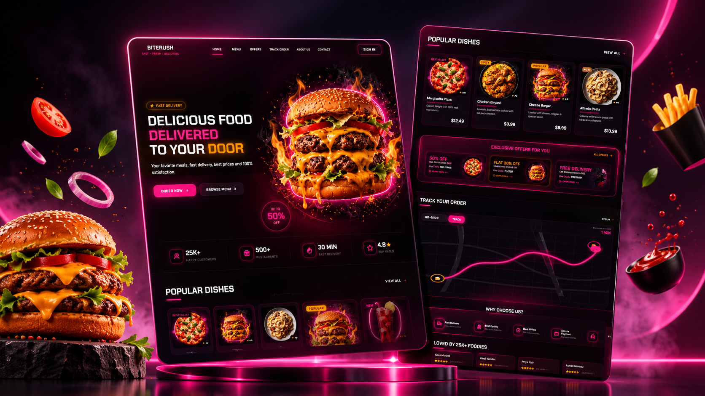

<div align="center">

# 🍔 neonbite-landing-page



### Crave. Click. Glow.

A neon-lit, dark-themed food delivery web experience built with  
**React**, **Tailwind CSS** and **GSAP**.

[](https://react.dev)
[](https://tailwindcss.com)
[](https://gsap.com)
[](https://vitejs.dev)
[](LICENSE)

[🚀 Live Demo](https://your-demo-link.com) · [🐛 Report Bug](../../issues) · [✨ Request Feature](../../issues)

<br />


</div>

---

## ✨ Overview

**NeonBite** is a modern food delivery front-end that combines a glowing
neon aesthetic with buttery-smooth motion. From the hero section to the cart
flow, every interaction is designed to feel fast, playful and appetizing.

## 🔥 Features

- 🎨 **Neon dark UI** – glowing borders, gradients and shadows
- 🎬 **GSAP animations** – hero entrance, scroll-triggered reveals, hover micro-interactions
- 🍕 **Food categories** – Pizza, Burger, Biryani, Pasta, Sushi, Desserts, Drinks
- ⭐ **Popular dishes** – cards with badges (Bestseller, Spicy, New…)
- 🎟️ **Exclusive offers** – promo sections with coupon codes
- 🛒 **Cart & checkout preview** – mobile-style cart UI
- 📱 **Fully responsive** – desktop, tablet and mobile
- 📲 **App download section** – store buttons + QR code
- ⚡ **Blazing fast** – powered by Vite|

## 🚀 Getting Started

### Prerequisites
- Node.js ≥ 18
- npm / yarn / pnpm

### Installation

```bash
# 1. Clone the repository
git clone https://github.com/your-username/neonbite.git

# 2. Go to the project folder
cd neonbite

# 3. Install dependencies
npm install

# 4. Start the dev server
npm run dev
```

Open **http://localhost:5173** in your browser.

### Build for production

```bash
npm run build
npm run preview
```